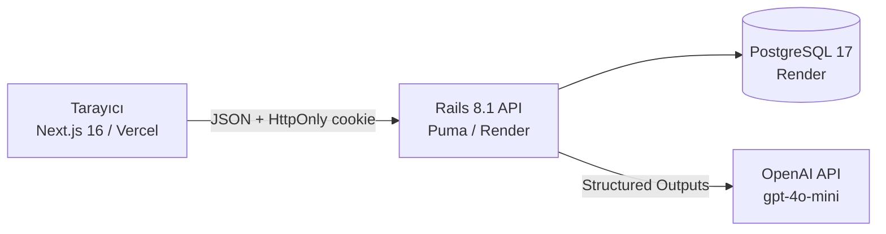

# ResolveIQ

**Destek ekibiniz yazmasın, karar versin.** ResolveIQ, AI-native bir müşteri destek platformudur. Gelen talepleri sınıflandırır, benzer şikayetlerden olası ortak sorunu çıkarır, etkilenen tüm müşteriler için ortak yanıtı ve aksiyonları hazırlar. Destek uzmanı yalnızca inceler ve onaylar.

| | |
|---|---|
| Canlı uygulama | https://resolveiq.mehmetdogandev.com (canlı doğrulandı, sonuçlar: [docs/deployment.md](docs/deployment.md#8-canlı-doğrulama-sonuçları)) |
| Canlı API | https://api-resolveiq.mehmetdogandev.com/api/v1/health |
| Repo | https://github.com/mehmetdogandev/resolveiq |
| Demo girişi | Giriş ekranındaki demo kullanıcı düğmeleri. Parola: `resolveiq2026` |
| Pitch deck | [docs/ResolveIQ-pitch-deck.pdf](docs/ResolveIQ-pitch-deck.pdf) (kaynak: [docs/pitch-deck.html](docs/pitch-deck.html)) |

Demo kullanıcıları (tamamı sentetik):

| Kullanıcı | Rol | E-posta |
|-----------|-----|---------|
| Selin Aydın | Yönetici (manager): olay onayı, toplu uygulama, makale yayını, denetim kaydı | `selin@resolveiq.demo` |
| Burak Demir | Uzman (agent), Batarya ve Şarj Ekibi | `burak@resolveiq.demo` |
| Ayşe Kara | Uzman (agent), Garanti ve İade Ekibi | `ayse@resolveiq.demo` |
| Emre Yılmaz | Uzman (agent), Teknik Destek Ekibi | `emre@resolveiq.demo` |

Tüm müşteri, ürün ve ticket verisi sentetiktir. Ürünler hayali bir el aleti markası olan **Northforge Tools** için uydurulmuştur (VC-20 matkap, PC-5 batarya, QC-2 şarj cihazı vb.). Müşteri e-postaları `example.com` / `example.net` alan adlarını kullanır.

## Seçilen firma, SaaS ve kanıt

| | |
|---|---|
| Fortune 500 firması | **Stanley Black & Decker** |
| Kullandığı SaaS | **Zendesk** (müşteri destek platformu: Support, Guide, Chat, Talk) |
| Kanıt 1 | [Zendesk müşteri hikayeleri, üretim sektörü: "Stanley Black & Decker and Zendesk"](https://www.zendesk.co.uk/customer/manufacturing/) |
| Kanıt 2 | [Zendesk Customer Story e-kitabı, Bölüm 1 (PDF)](http://d26a57ydsghvgx.cloudfront.net/content/resources/Zendesk_CustomerStoryEbook.pdf) |

Kaynaklara göre Stanley Black & Decker ayda yaklaşık **10.000 ticket** işliyor. Türkiye, Peru, Arjantin ve Brezilya'daki çağrı merkezlerini Zendesk Support, Guide, Chat ve Talk ile tek platformda birleştirmiş.

**Klonlanan ana değer akışı:** çok kanallı destek taleplerini tek bir yerde toplamak, doğru kişiye yönlendirmek, bilgi bankasıyla çözmek ve müşteriye yanıt vermek. ResolveIQ bu akışı kendi markası, kendi arayüzü ve kendi koduyla yeniden kurar. Zendesk'in adı, logosu, renkleri ve giriş ekranı kullanılmaz. Kapalı kaynak kod, tersine mühendislik veya scrape edilmiş veri yoktur.

## Klonlanan iş akışları

| # | İş akışı | Kapsam |
|---|----------|--------|
| A | Ticket yönetimi | Oluşturma (doğrulamalı form), listeleme, sunucu taraflı filtre ve sıralama, atama, durum ve öncelik, müşteriye yanıt ve iç not, çözme ve yeniden açma, denetim kaydı |
| B | Birleşik gelen kutusu ve müşteri geçmişi | E-posta, web formu ve canlı sohbet tek listede; kanal sekmeleri ve sayıları; durum/öncelik/sorumlu/kategori filtreleri; seçili talebin önizlemesi; müşterinin tüm kanallardaki geçmişi |
| C | Bilgi bankası ve çözüm | Makale oluşturma/düzenleme, taslak ve yayın (yalnızca yönetici yayınlar), arama ve filtre, ticket'a makale bağlama, makale adımlarını tek tıkla yanıt taslağına ekleme, çözüp kapatma |
| D | SLA, makro, otomasyon | Önceliğe göre ilk yanıt/çözüm hedefleri, hazır yanıt makroları, etiketler, toplu güncelleme, ticket birleştirme, anahtar kelime tetikleyicileri |
| E | Help center, CSAT, rapor | Public yardım merkezi ve web formu, çözülen ticket CSAT, FRT/çözüm/SLA/kanal/temsilci raporları |

Kanallar sentetiktir. Gerçek e-posta veya sohbet entegrasyonu yoktur; ticket'ın `channel` alanı kaynağı temsil eder.

## AI-native katman: "kullanılabilir pas"

Klasik destek aracında uzman her ticket'ı okur, sınıflandırır, kime gideceğine karar verir, makale arar ve yanıtı sıfırdan yazar. Aynı sorundan gelen 6 şikayeti fark etmek de tamamen insanın hafızasına kalmıştır. ResolveIQ'da üç ajan bu işi hazırlar, insan yalnızca kararı verir. **Hiçbir ajan müşteriye kendiliğinden mesaj göndermez.**

| Ajan | Ne hazırlar? | İnsan ne yapar? |
|------|--------------|-----------------|
| **A. Akıllı triage** | Kategori, öncelik, ekip ve uzman önerisi (açık iş yüküne göre), ilgili yayındaki makaleler, gerekçe ve kanıt, güven skoru, yanıt taslağı | Öneri farklarını (mevcut → önerilen) görür, istediği alanları işaretleyip "Önerileri uygula"ya basar; taslağı yanıt kutusuna alıp düzenler |
| **B. Örüntü tespiti** | Son 30 günün ticket'larını TF-IDF benzerliğiyle gruplar (LLM'den önce şeffaf bir filtre), sonra LLM grubu inceler: ortak belirtiler, kanıt, olası kök neden, belirsizlik, etki, güven. Sonuç **"Önerildi (hipotez)"** durumunda bir olay (incident) olarak kaydedilir | Kanıtı inceler; onaylar veya reddeder. Onaylanmamış olay doğrulanmış sayılmaz. Benzerlik nedensellik olarak sunulmaz |
| **C. Çözüm ve önleme** | Olay için sorun giderme adımları, ortak müşteri yanıtı (`{{musteri_adi}}` yer tutucusuyla), iç eskalasyon önerisi, ticket bazında aksiyon önerisi, bilgi bankası boşluğu varsa makale taslağı | Ortak yanıtı düzenler, ticket'ları seçer, sonraki durumu seçer ve iki adımlı onayla uygular. Makale taslağını kaydeder; yayın yönetici onayı ister |

Kullanıcı önünde her zaman bir sonraki adım hazırdır: ticket'ta triage önerisi ve çözüm taslağı, gelen kutusunda benzer talep uyarısı, dashboard'da "Onay bekleyen AI işleri" listesi ve üst bardaki sayaç.

### Hangi manuel adımlar kalkıyor?

| Adım | Klasik destek aracında | ResolveIQ'da |
|------|-----------------------|--------------|
| Sınıflandırma ve yönlendirme | Uzman metni okur, kategori ve öncelik seçer, kime atayacağını düşünür | Öneri hazır gelir; uzman farkı görüp tek tıkla uygular |
| Makale bulma | Bilgi bankasında elle arama | İlgili yayındaki makaleler önerilir ve bağlanır; adımlar tek tıkla yanıta eklenir |
| İlk yanıtı yazma | Sıfırdan yazılır | Taslak hazır; uzman düzenleyip gönderir |
| Ortak sorunu fark etme | Farklı kanallardan gelen benzer şikayetleri bir kişinin fark etmesi gerekir | Örüntü taraması grubu, kanıtı ve etkilenen müşterileri çıkarır |
| Etkilenen her müşteriye yanıt | 6 ticket'a tek tek yanıt, durum güncelleme | Tek ortak yanıt, kişiselleştirilmiş olarak seçili ticket'lara tek onayla eklenir |
| Bilgi bankası boşluğunu kapatma | Genellikle hiç yapılmaz | Ajan boşluğu işaretler ve makale taslağını hazırlar |

### AI güvenliği ve dürüstlük ilkeleri

- LLM çağrıları ve API anahtarı yalnızca Rails tarafındadır; tarayıcıya anahtar gitmez. Model: OpenAI `gpt-4o-mini`, Structured Outputs (katı JSON şeması).
- Prompt'lara müşteri adı gönderilmez; e-posta, telefon ve seri numarası maskelenir (`PiiScrubber`).
- Model çıktısı sunucuda doğrulanır: var olmayan kategori, uzman olmayan sorumlu, yayında olmayan makale gibi öneriler düşürülür ve `dropped_suggestions` olarak gösterilir.
- Her ajan çağrısı `agent_runs` tablosuna kaynak, model, token, süre, tahmini maliyet ve sağlayıcı istek kimliğiyle yazılır (başarısız çağrılar dahil).
- Anahtar yoksa AI uçları **503** ve kurulum talimatı döner; arayüz "AI kullanılamıyor" der, sahte çıktı üretilmez. Deterministik fallback yalnızca `AI_DEMO_MODE=1` ile açılır ve her yerde **"Fallback (LLM yok)"** rozetiyle işaretlenir. Sağlayıcı hatası **502** döner, yerine sessizce fallback konmaz.
- Maliyet yalnızca gerçek OpenAI çağrılarında hesaplanır ve "tahmini" olarak etiketlenir (fiyatlar env değişkeniyle ayarlanır).

## Mimari



- **Frontend (`web/`):** Next.js 16 App Router, React 19, TypeScript, Tailwind CSS 4, SWR, lucide-react. Tüm veri istemci tarafında JSON API'den çekilir.
- **Backend (`api/`):** Rails 8.1 API-only, PostgreSQL, bcrypt, rack-cors. İş mantığı servis nesnelerindedir (`TicketOperations`, `IncidentOperations`, `TriageAgent`, `PatternDetector`, `ResolutionAgent`, `DashboardMetrics` vb.).
- Ayrıntılar: [docs/architecture.md](docs/architecture.md).

## Güvenlik

- Parolalar bcrypt ile hash'lenir. Oturum belirteci `HttpOnly; SameSite=Lax` (production'da `Secure`) cookie'de durur; veritabanında yalnızca SHA-256 özeti tutulur, oturum 7 gün geçerlidir.
- Yetki sunucuda kontrol edilir: makale yayını, yayındaki makaleyi düzenleme, olay onayı/reddi/kapatma, toplu yanıt uygulama ve denetim kaydı yalnızca yöneticiye açıktır (403).
- Hata yanıtları tutarlıdır: 400, 401, 403, 404, 422 (alan bazlı `details`), 429, 500, 502 (AI sağlayıcı), 503 (AI yapılandırılmamış).
- GET dışındaki isteklerde `Origin` başlığı izin listesiyle karşılaştırılır (CSRF). CORS yalnızca `FRONTEND_ORIGIN` listesine açıktır; production'da bu değişken yoksa uygulama açılmaz.
- Girişte (10/dk) ve AI uçlarında (30/dk) hız sınırı vardır. Demo reset ucu `X-Admin-Token` ile korunur.

## Yerel kurulum

Gereksinimler: Ruby 3.3, Node 20.9+, Docker.

```bash
docker compose up -d                 # PostgreSQL 17, localhost:5434

cd api
bundle install
bin/rails db:prepare                 # şema + sentetik demo verisi
AI_DEMO_MODE=1 bin/rails server -p 3001
# Gerçek LLM için: OPENAI_API_KEY=... bin/rails server -p 3001
# İkisi de yoksa AI uçları 503 döner (tasarım gereği).

cd ../web
cp .env.example .env.local           # NEXT_PUBLIC_API_URL=http://localhost:3001
npm install
npm run dev                          # http://localhost:3000
```

Geliştirmede `FRONTEND_ORIGIN` verilmezse `http://localhost:3000` kabul edilir. Farklı port kullanıyorsanız API'yi `FRONTEND_ORIGIN=http://localhost:<port>` ile başlatın. Demo verisini sıfırlamak için: `bin/rails demo:reset`.

## Testler

```bash
cd api && bin/rails test
cd web && npx eslint . && npx next typegen && npx tsc --noEmit && npm run build
```

Son yerel çalıştırma (2026-10-18): **39 test, 240 doğrulama, 0 hata**. ESLint, TypeScript ve production build temiz.

Testler şunları kapsar: health, veritabanı kesintisinde 503 ve CORS; giriş, cookie bayrakları, yalnızca token özetinin saklanması ve origin kontrolü; ticket yaşam döngüsü, 404/422 yanıtları ve filtreler; gelen kutusu ve müşteri geçmişi; bilgi bankası yetkileri (agent yayınlayamaz, 403); triage doğrulaması (geçersiz ID'lerin düşürülmesi, triage'ın müşteriye mesaj göndermemesi); sağlayıcı hatasında 502 ve başarısız `agent_run` kaydı; anahtar yokken 503; örüntü tespitinin 6 benzer ticket'ı bulup kontrol ticket'larını dışarıda bırakması; olay onayı olmadan toplu uygulamanın reddedilmesi; ortak yanıtın kişiselleştirilmesi; maliyetin yalnızca gerçek çağrılarda hesaplanması; idempotent seed; demo reset ucunun token gerektirmesi ve numaralandırmayı sıfırlaması.

Yerel tarayıcı smoke testi (2026-10-18, `AI_DEMO_MODE=1`): giriş, dashboard, ticket listesi, triage çalıştırma ve uygulama, örüntü taraması (6 ticket'lık PC-5 grubu), olay onayı, çözüm paketi, 6 ticket'a ortak yanıt uygulama (`Merhaba Kerem,` olarak kişiselleşti), gelen kutusu, bilgi bankası yayınla/kaldır ve müşteri geçmişi elle denendi.

## Deploy

Render (API + PostgreSQL, `render.yaml` Blueprint), Vercel (frontend, kök dizin `web`), Cloudflare DNS. Adımlar ve canlı doğrulama komutları: [docs/deployment.md](docs/deployment.md). Sunum akışı: [docs/demo-script.md](docs/demo-script.md).

## Sınırlamalar

- Kanallar simüle edilir; gerçek e-posta/sohbet/telefon entegrasyonu yoktur. SLA, makro ve tetikleyiciler uygulama içi kurallardır (Twilio/WhatsApp/SSO yok).
- Benzerlik araması basit bir TF-IDF ve önek kökleme kullanır; büyük hacimde vektör veritabanı gerekir.
- Örüntü taraması elle tetiklenir (arka plan işi yok); her taramada en fazla birkaç grup LLM'e gönderilir.
- Cookie oturumu frontend ve API aynı üst alan adı altında (`*.mehmetdogandev.com`) olduğu için çalışır. `*.vercel.app` önizleme adresinden giriş yapılamaz.
- Render ücretsiz katmanında API uykuya geçer; ilk istek 30-60 saniye sürebilir. Ücretsiz Postgres 30 gün sonra sona erer.
- Lisans maliyeti karşılaştırması bir senaryo tahminidir; Stanley Black & Decker'in gerçek sözleşmesi bilinmemektedir.

## Metrik tablosu

Ayrıntılı kayıt ve ölçüm yöntemleri: [METRICS.md](METRICS.md).

| Metrik | Değer |
|--------|-------|
| Toplam token maliyeti, geliştirme ($) | ~44,1 M token (Cursor Usage: günlük 79,9 M − jokerai-jai 35,8 M), plan dahilinde. API ile ödenseydi tahmini: Grok Build 12,5 $ · Claude Sonnet 5.5 19,5 $ · Grok 4.7 30,9 $ · Claude Opus 5.5 39 $ (varsayımlar METRICS.md'de) |
| Toplam token maliyeti, canlı ürün içi AI ($) | 0,00366 (8 gpt-4o-mini çağrısı, `agent_runs`'tan; triage ticket başına ~0,0003 $) |
| Toplam çalışma süresi (saat) | 0,99 (3 agent oturumu; saatler METRICS.md'de) |
| Satır sayısı (LOC) | 7.242 boş olmayan satır (API 2.770, API test 493, web 3.911, kök 68) |
| Kullanılan model(ler) | Geliştirme: Cursor Agent, Auto modeli. Ürün içi ajan: OpenAI gpt-4o-mini |
| Coding agent(lar) | Cursor Agent |
| Agent oturum sayısı | 3 |
