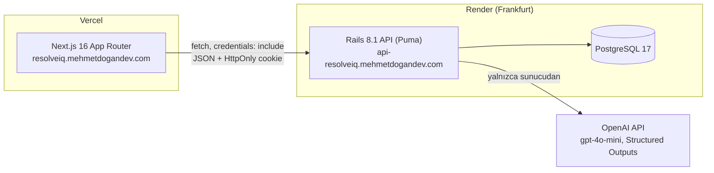
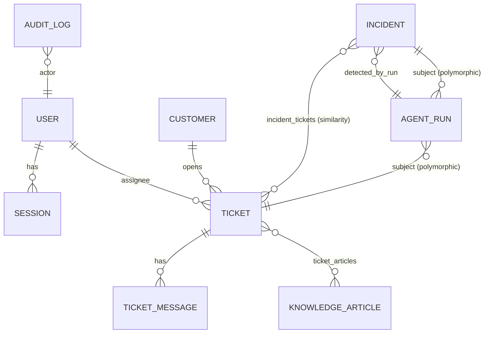
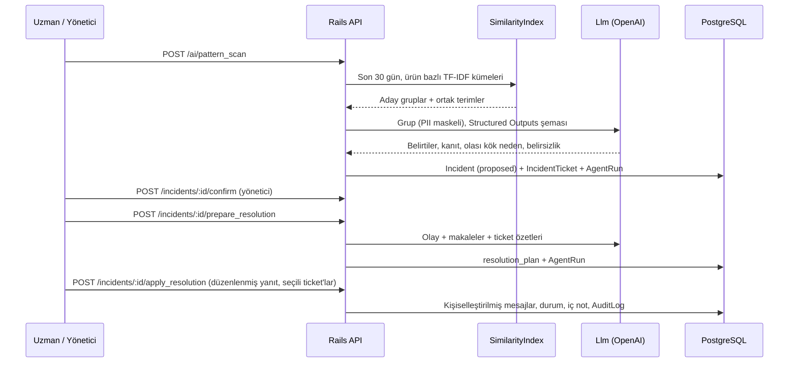

# ResolveIQ mimarisi

## Genel bakış

- Monorepo: `web/` (frontend) ve `api/` (backend). İki uygulama yalnızca `/api/v1` altındaki JSON HTTP API ile konuşur.
- Frontend tamamen istemci tarafında veri çeker (SWR). Sunucu bileşenlerinde gizli bilgi yoktur. Tarayıcıya giden tek ortam değişkeni `NEXT_PUBLIC_API_URL`'dir.
- LLM anahtarı (`OPENAI_API_KEY`) yalnızca Render ortam değişkenidir.

## Backend katmanları

| Katman | Dosyalar | Sorumluluk |
|--------|----------|------------|
| Controller | `app/controllers/api/v1/*` | Parametre, yetki, HTTP durum kodu. İş mantığı içermez |
| Concern | `Authentication`, `Authorization`, `OriginCheck` | Cookie oturumu, rol kontrolü (403), CSRF için Origin izin listesi |
| Servis | `TicketOperations`, `IncidentOperations`, `TriageAgent`, `TriageApplier`, `PatternDetector`, `ResolutionAgent`, `AgentRunner`, `Llm`, `SimilarityIndex`, `PiiScrubber`, `DashboardMetrics`, `HealthCheck`, `DemoSeed` | Tüm iş kuralları ve AI akışları |
| Sunum | `TicketPresenter`, modellerdeki `summary_json` / `detail_json` | API yanıt şekli |
| Model | `User`, `Session`, `Customer`, `Ticket`, `TicketMessage`, `KnowledgeArticle`, `TicketArticle`, `Incident`, `IncidentTicket`, `AgentRun`, `AuditLog` | Doğrulama, enum, kapsam (scope) |

### Veri modeli

Veritabanı kısıtları: enum alanlarında check constraint, çözülmüş ticket'ta `resolved_at` zorunluluğu, müşteri mesajlarının iç not olamaması, olay güveninin 0..1 aralığında olması, `lower(email)` ve ticket numarası için benzersiz indeksler, etiketlerde GIN indeksi.

### Hata sözleşmesi

Tüm hatalar `{ "error": "...", "code": "...", "details"?: {...} }` biçimindedir.

| Durum | Ne zaman |
|-------|----------|
| 400 | Eksik parametre, geçersiz işlem (ör. onaylanmamış olaya toplu yanıt) |
| 401 | Oturum yok veya süresi dolmuş |
| 403 | Rol yetkisi yok, izin verilmeyen Origin |
| 404 | Kayıt yok |
| 422 | Doğrulama hatası, alan bazlı `details` ile |
| 429 | Hız sınırı (giriş 10/dk, AI 30/dk) |
| 502 | AI sağlayıcı hatası (zaman aşımı, 5xx); başarısız `agent_run` kaydedilir |
| 503 | AI yapılandırılmamış (`ai_unavailable`, kurulum talimatıyla) veya health'te veritabanı kapalı |

## AI katmanı

- **`Llm` adaptörü** dört mod: `openai` (anahtar varsa), `fallback` (yalnızca `AI_DEMO_MODE=1`), `fake` (test ortamı), `unavailable` (503). OpenAI istemcisi 30 sn zaman aşımı ve 429/5xx/ağ hatalarında 2 yeniden deneme kullanır.
- **`AgentRunner`** her çağrıyı başarılı ya da başarısız `agent_runs` kaydına çevirir: kaynak, model, token, gecikme, tahmini maliyet (`AiPricing`, yalnızca `openai`), sağlayıcı istek kimliği.
- **Sanitize adımı** model çıktısını veritabanına göre doğrular; geçersiz öneriler `dropped_suggestions` alanına düşer.
- **Benzerlik**: Türkçe karakter katlama, durak kelimeler, 6 harflik önek kökleme, TF-IDF kosinüs. Eşikler: ilişkili ticket 0,22; küme bağlantısı 0,30; grup ortalaması en az 0,22; en az 3 ticket. LLM grubu inceleyip ilgisiz üyeleri çıkarabilir.
- **Güvenli kalıcılık**: tarama yalnızca `proposed` olay yaratır. Olay onaylanmadan toplu yanıt uygulanamaz. Ajanlar müşteri mesajı göndermez; mesajlar yalnızca insanın açık onayıyla eklenir.

## Frontend yapısı

| Yol | Ekran |
|-----|-------|
| `/login` | Demo kullanıcı düğmeleri, form, API durumu |
| `/dashboard` | Veritabanından hesaplanan metrikler, onay bekleyen AI işleri, olaylar, dağılımlar, son AI çalıştırmaları, etkinlik |
| `/tickets`, `/tickets/new`, `/tickets/[id]` | Liste ve filtreler; oluşturma (isteğe bağlı otomatik triage); ticket çalışma alanı (konuşma, yanıt, triage, özellikler, ilişkili kayıtlar, bilgi bankası, çözüm önerisi) |
| `/inbox` | Birleşik gelen kutusu: liste + önizleme + müşteri geçmişi |
| `/customers/[id]` | Müşteri geçmişi |
| `/knowledge`, `/knowledge/new`, `/knowledge/[slug]` | Bilgi bankası listesi, oluşturma, görüntüleme/düzenleme, yayın |
| `/ai-insights` | Örüntü taraması, olay inceleme, çözüm paketi, AI çalıştırma geçmişi ve maliyet |

Ortak parçalar: `lib/api.ts` (tek fetch sarmalayıcısı, `ApiError`), `lib/types.ts` (API tipleri), `components/session.tsx` (oturum + meta), `components/ui.tsx` (tasarım bileşenleri).

## Kararlar

| Karar | Gerekçe |
|-------|---------|
| Cookie oturumu, token değil | JavaScript belirtece erişemez; aynı üst alan adında `SameSite=Lax` yeterli |
| Migration ve seed build adımında | Render ücretsiz planında pre-deploy yok; açılışta migration çalıştırmak güvensiz |
| Arka plan kuyruğu yok | Ücretsiz katmanda ayrı worker yok; AI çağrıları kullanıcı isteğiyle senkron ve kısa |
| LLM öncesi TF-IDF filtresi | Maliyeti düşürür, kanıtı şeffaf kılar, LLM'e yalnızca aday gruplar gider |
| Deterministik fallback etiketli ve isteğe bağlı | Demo güvenliği sağlar ama gerçek AI gibi sunulmaz |
